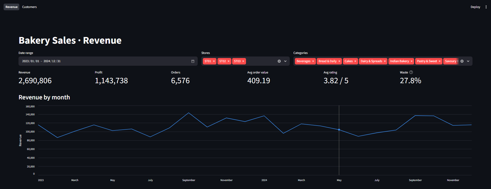
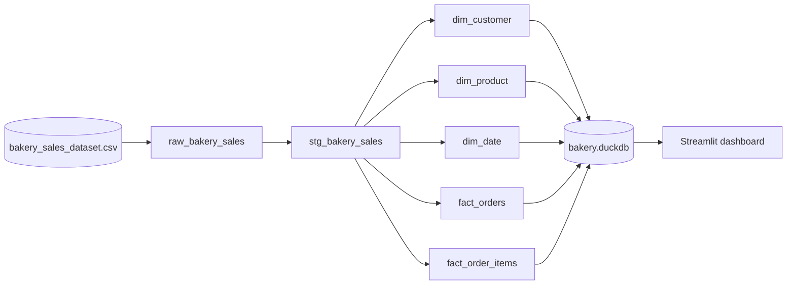
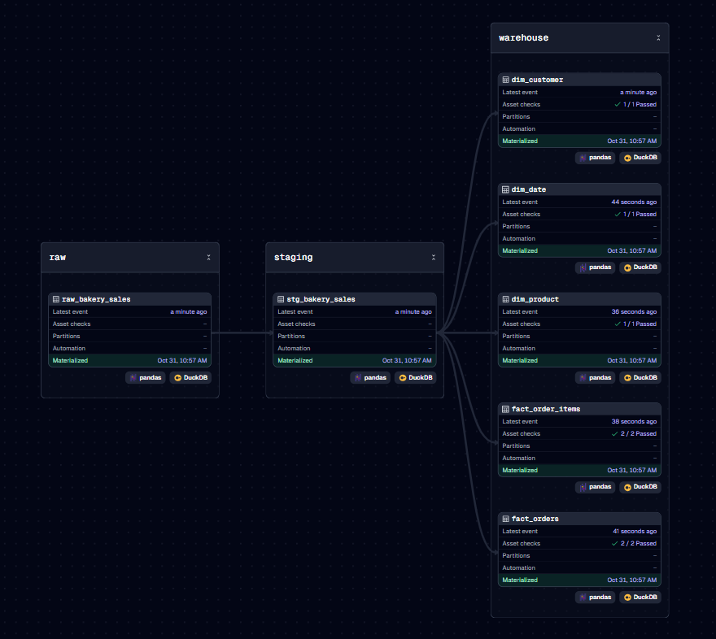
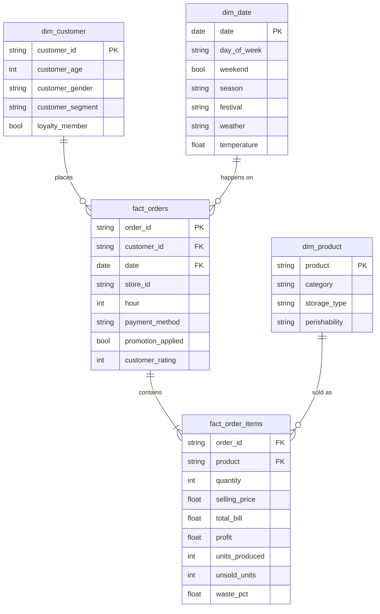
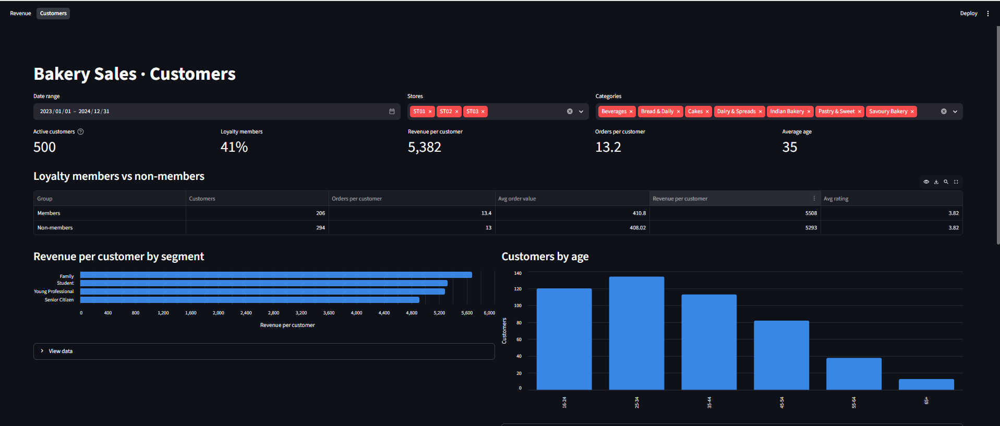

# 🥐 Bakery Sales Pipeline

An end-to-end data pipeline that turns a flat CSV of bakery sales into a queryable star schema and an interactive dashboard.

**Dagster** orchestrates the pipeline, **DuckDB** stores the warehouse, and **Streamlit** serves the dashboard.




## Highlights

- **Layered pipeline:** raw → staging → warehouse. Each step is a Dagster asset with lineage you can see in the UI.
- **Star schema in DuckDB:** 3 dimension tables and 2 fact tables, built from 19,321 order lines.
- **Data quality checks:** unique keys, row count reconciliation, and value range checks run after every build.
- **Automatic reruns:** a file sensor rebuilds everything when the source CSV changes.
- **Two-page dashboard:** revenue and customer breakdowns, with shared filters for date, store and category.

## Architecture



### Asset lineage in Dagster



| Layer | Asset | What it does |
| --- | --- | --- |
| Raw | `raw_bakery_sales` | Loads the CSV as-is, one row per order line |
| Staging | `stg_bakery_sales` | Lowercases column names, parses dates, converts Yes/No columns to booleans |
| Warehouse | `dim_customer` | One row per customer (500) |
| | `dim_product` | One row per product (35) |
| | `dim_date` | One row per day (731), with weather and festivals |
| | `fact_orders` | One row per order (6,576) |
| | `fact_order_items` | One row per product within an order (19,321) |

Each asset returns a pandas DataFrame. Dagster's `DuckDBPandasIOManager` writes it to a DuckDB table of the same name, so the asset code contains no database code.

## Data model



## Data quality checks

Dagster asset checks run after each table is built and show pass/fail in the UI:

| Table | Check |
| --- | --- |
| `dim_customer`, `dim_product`, `dim_date`, `fact_orders` | Primary key is unique and never null |
| `fact_order_items` | Exactly one row per raw sales row |
| `fact_order_items` | Quantity is positive, `waste_pct` is between 0 and 100, no missing order IDs |
| `fact_orders` | `customer_rating` is between 1 and 5 |

## Dashboard

### Revenue

Headline numbers for revenue, profit, orders, average order value, rating and waste, plus monthly revenue, the most profitable and most wasteful products, and sales by hour and weekday.


### Customers

Loyalty members compared with non-members, revenue per customer by segment and gender, age bands, order frequency, and a top customers table.



## Getting started

### Prerequisites

- [uv](https://docs.astral.sh/uv/getting-started/installation/) (it installs Python for you if needed)
- The [bakery sales dataset](LINK_TO_KAGGLE_DATASET) from Kaggle

### 1. Clone and install

```bash
git clone https://github.com/<your-username>/bakery-pipeline.git
cd bakery-pipeline/bakery-dagster
uv sync
```

### 2. Add the dataset

Save the CSV as:

```
bakery-dagster/src/bakery_dagster/defs/data/bakery_sales_dataset.csv
```

### 3. Run the pipeline

```bash
uv run dg dev
```

Open http://localhost:3000, go to **Lineage**, and click **Materialize all**. This builds every table into `bakery-dagster/bakery.duckdb` and runs the data quality checks.

Optional: under **Automation**, turn on `bakery_csv_sensor` to rebuild automatically whenever the CSV changes.

### 4. Open the dashboard

In a second terminal, also inside `bakery-dagster`:

```bash
uv run streamlit run dashboard/app.py
```

Open http://localhost:8501.

### 5. Query the warehouse yourself (optional)

```python
import duckdb

con = duckdb.connect("bakery.duckdb", read_only=True)
con.sql("""
    SELECT p.category, ROUND(SUM(i.profit), 2) AS profit
    FROM fact_order_items i
    JOIN dim_product p USING (product)
    GROUP BY ALL
    ORDER BY profit DESC
""").show()
con.close()
```

> [!NOTE]
> DuckDB allows only one process to write to the database file at a time. Close any notebook connections before clicking **Materialize all**. The dashboard is safe to leave open: it opens a short read-only connection for each query.

## Project structure

```
bakery-pipeline/
├── docs/images/                 # README screenshots
└── bakery-dagster/
    ├── pyproject.toml
    ├── dashboard/
    │   ├── app.py               # entry point: page navigation and shared filters
    │   ├── common.py            # DuckDB queries and chart helpers
    │   ├── revenue.py           # Revenue page
    │   └── customers.py         # Customers page
    └── src/bakery_dagster/defs/
        ├── data/                # source CSV (not committed)
        ├── resources.py         # DuckDB IO manager
        ├── raw.py               # extract
        ├── staging.py           # clean and type
        ├── warehouse.py         # star schema
        ├── checks.py            # asset checks
        └── automation.py        # job and file sensor
```

## Tech stack

| Tool | Role |
| --- | --- |
| [Dagster](https://dagster.io/) | Orchestration, lineage, asset checks, sensors |
| [DuckDB](https://duckdb.org/) | Embedded analytical warehouse |
| [pandas](https://pandas.pydata.org/) | Transformations |
| [Streamlit](https://streamlit.io/) + [Altair](https://altair-viz.github.io/) | Dashboard and charts |
| [uv](https://docs.astral.sh/uv/) | Dependency and environment management |
